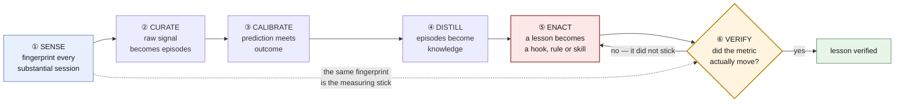
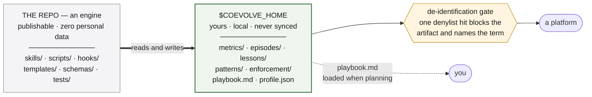

# coevolve

A closed feedback loop over your own use of Claude Code. It records how you
actually work with an AI assistant, distils that into a playbook you read and a
profile a platform can consume — and then **changes your harness so the lessons
stick**, and measures whether your behaviour actually changed.

## Why the last part matters

Most "AI productivity tracking" stops at writing things down. Writing things
down does not change behaviour.

The evidence that shaped this design came from an earlier version of the system
itself. A lesson about pasting credentials into a transcript was recorded on one
date. The same mistake happened again two weeks later. The note was accurate,
well-written, and completely absent from the moment it was needed.

So the loop has six stages, and the last two are the point.

## The loop



⑥ feeding back into ⑤ is what makes this a loop rather than a pipeline. The
dotted edge is the part that makes ⑥ possible at all: the fingerprint taken
automatically in ① is the same measurement VERIFY compares across, so nothing
downstream depends on self-report.

**Stages ① and ② are automatic.** A `Stop` hook fingerprints the session and
queues it; a `SessionStart` hook tells you when a stage is overdue. Everything
else you invoke when the nudge says so.

## Install

```
/plugin marketplace add <this repo>
/plugin install coevolve
```

Then run `coevolve:setup`. It creates `~/.claude/coevolve/`, asks for the terms
that must never leave your machine, and offers to migrate an existing
dev-worklog installation.

Requires `python3`, `bash`, and `jq`. No Python packages, no Notion account, no
network calls.

## Using it

**Once, at the start.** Run `coevolve:setup`. The only thing it needs from you
is the denylist — customer names, internal service names, anything that must
never leave the machine. Everything else has a default in `config.md`.

**Then do nothing for a couple of weeks.** The loop needs sessions before it can
say anything, and a profile built on three sessions is fiction — the system will
tell you so rather than guess. Capture is already running.

> Transcripts are retained for roughly 30 days, so ① runs at session end.
> Whatever is not fingerprinted while the transcript exists cannot be recovered.
> This is the one part of the loop that cannot be caught up on later.

**When a nudge fires**, run `coevolve:status`. It is read-only and recommends
exactly one next action — an enforcement gap outranks a full inbox, because
volume is the loudest signal and the least important.

**The ordinary rhythm**, once there is data:

| When | What | Why |
|---|---|---|
| when the inbox fills | `coevolve:curate` | flags and fingerprints become episodes while you still remember them |
| every couple of weeks | `coevolve:calibrate` | your prediction meets the outcome; the gap is the lesson |
| monthly | `coevolve:distill` | episodes become habits, patterns, lessons, and a playbook diff |
| when a lesson is high-severity | `coevolve:enact` | it becomes a hook, a rule, or a skill — not another bullet |
| a few weeks after enacting | `coevolve:verify` | did the number move, or did you just write something down |
| when a platform asks | `coevolve:profile` | export the portable, de-identified cowork profile |

**The one thing to understand about ⑤.** Registering a hook edits your settings,
so ENACT never does it silently. It hands you an installer command and leaves
the lesson at `state: logged`, which keeps the session-start nudge complaining
until the enforcement is genuinely live. A lesson stamped `enacted` for a hook
nobody registered looks handled, is not, and silences the only thing that would
have reminded you.

## What gets measured

A deterministic extractor reads session transcripts — no LLM, no self-report —
and emits counts only:

- tool histogram, and which **skills** were actually invoked by name
- which **subagent types** were dispatched, and how much work happened inside them
- **model mix** across the session
- tool error rate, and how often you **interrupted** the assistant
- how many real steering turns a session needed
- session span, token usage, permission mode

Two rules keep it safe and useful: it contains **counts and vocabulary names
only, never content**, and it is computed identically every time — otherwise
before/after comparison means nothing.

## Skills

| Skill | Stage | What it does |
|---|---|---|
| `coevolve:setup` | — | one-time scaffold, denylist, migration |
| `coevolve:status` | — | read-only navigator; recommends exactly one next action, plus a report mode |
| `coevolve:predict` | ① | ten-second prediction before the outcome is known |
| `coevolve:curate` | ② | flags + fingerprints + predictions → episodes |
| `coevolve:calibrate` | ③ | prediction versus outcome; corrects the record |
| `coevolve:distill` | ④ | habits, patterns, lessons, profile → playbook diff |
| `coevolve:enact` | ⑤ | a lesson becomes a hook, a rule, or a skill |
| `coevolve:verify` | ⑥ | did the metric actually move |
| `coevolve:profile` | ④ | export the portable cowork profile |
| `dev-playbook` | — | loads your playbook when planning work |

## Engine and profile are separate

The repo is an engine. It ships skills, scripts, hooks, schemas, templates and
tests, and contains **no personal data** — there is a test that enforces this,
including against your own denylist.



Inside the home, `metrics/` holds ① the fingerprints, `episodes/` ② the curated
work, `lessons/` the failure records and their state machine, `patterns/` the
reusable moves, and `enforcement/` the guards ⑤ actually writes — the one
directory that exists because a lesson stopped being a document. `playbook.md`
is the ④ distillate you read; `profile.json` is the one a platform consumes, and
the only artifact besides a Notion export that ever leaves the machine.

This separation is what lets the same repo be published publicly and installed
inside a company. It is also why the previous design — where the playbook was a
skill file full of one person's real project names — could not be shared at all.

**Each stage owns its artifacts and writes nowhere else.** ENACT writes only
under `lessons/` and `enforcement/`; the playbook belongs to DISTILL and the
calibration log to CALIBRATE. A stage that edits its neighbours' files makes
every later diff ambiguous about which stage claimed what.

## Privacy

- **Local artifacts stay detailed.** Episodes and lessons never leave the
  machine, so they are written in full. Blurring them at capture would cost the
  detail distillation needs, to protect a file that never travels.
- **De-identification happens at the exits.** Any Notion export and the profile
  export pass a deterministic denylist gate; a single hit blocks that artifact
  and names the term.
- **The fingerprint carries no content.** Not prompts, not code, not paths, not
  branch names. Project grouping uses a salted hash, so "sessions on the same
  project" works without the project's name ever existing outside your machine.
- The denylist itself is never exported, committed, or printed into a transcript.

## The cowork profile

`profile.json` is a portable, schema-validated summary of how one person works
with AI: measured interaction characteristics, what they delegate versus keep,
reusable patterns, live failure modes with their enforcement state, boundaries,
and their calibration bias. Every claim carries its evidence count and
confidence; claims without support are omitted rather than softened, and a
profile built on too little data says `insufficient_data` instead of guessing.

Schema: [`plugins/coevolve/schemas/profile.schema.json`](plugins/coevolve/schemas/profile.schema.json).

## Evals

Most of what these skills do is judgement, and there is no unit test for "did
ENACT refuse to invent a detector that could not fire". So the judgement half
has its own suite: twelve cases, each a synthetic `$COEVOLVE_HOME` with a trap
built into it, graded twice — once deterministically off the disk, once against
written assertions.

The rule that matters: **where the answer and the disk disagree, the disk wins.**
A run can claim restraint it did not exercise; a diff against a pristine copy of
the fixture cannot.

See [`plugins/coevolve/evals/README.md`](plugins/coevolve/evals/README.md) for
the protocol and the isolation rules, and
[`evals/findings.md`](plugins/coevolve/evals/findings.md) for what the runs
actually found — including several product defects that reached the shipped
code.

## Working on it

```bash
bash plugins/coevolve/tests/run-all.sh
```

One gotcha when developing against a local marketplace: an installed plugin is a
**version-pinned cache copy**, so edits to the repo do not take effect until the
version changes. `claude plugin update` will report you are already on the latest
version. Either bump `version` in `plugin.json`, or uninstall and reinstall:

```bash
claude plugin marketplace update coevolve
claude plugin uninstall coevolve && claude plugin install coevolve@coevolve
```

Acceptance criteria for every component are in
[`docs/acceptance.md`](docs/acceptance.md), written before the implementation.
Design rationale is in [`docs/architecture.md`](docs/architecture.md).

## License

MIT.
